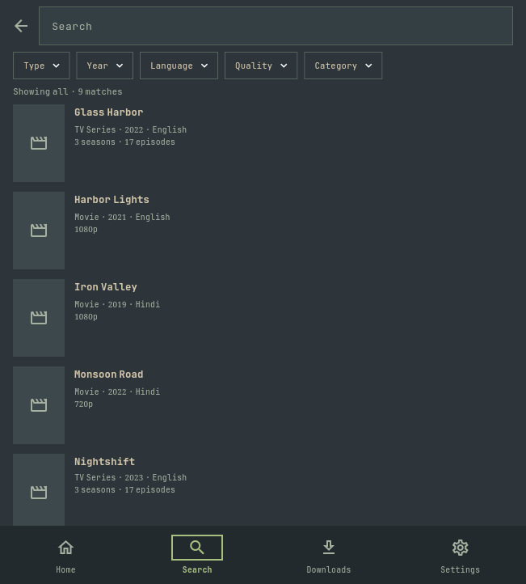
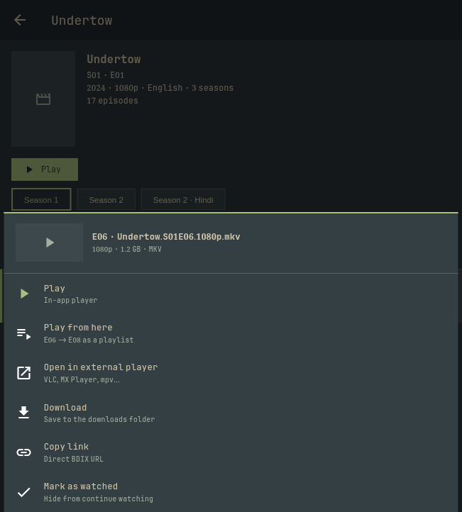
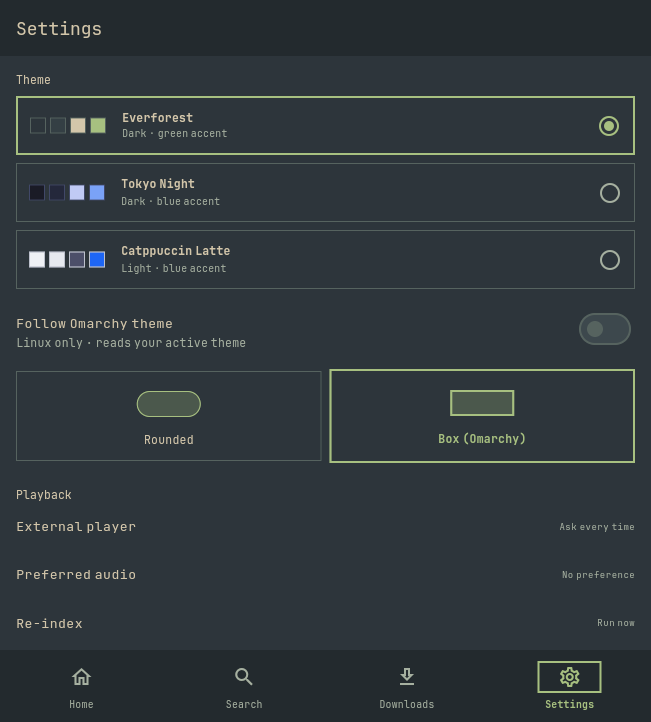

# watchdog

Unofficial Flutter client (Android and Linux) for browsing and playing media from the DhakaFlix h5ai servers.

## Disclaimer

- watchdog is **unofficial**: not affiliated with, authorized by, or endorsed by Sam Online or DhakaFlix.
- It **hosts no media** and ships no catalog or server data. It reads directory listings from servers you can reach and builds a local index on your device.
- You supply reachable servers. You are responsible for following the law and each server's terms.

## BDIX requirement

The DhakaFlix servers are reachable only from a BDIX-peered ISP in Bangladesh, not from cloud hosts or CI. Crawling and playback need that connection; the local index can be searched offline.

## Features

- Browse by category, search with fuzzy matching, filter by year, language and category
- Series view as a playlist of seasons and episodes
- In-app player (media_kit/libmpv) with audio and subtitle track switching
- Hand-off to an external player, copy link, downloads
- Themes (Everforest default, Tokyo Night, Catppuccin Latte) and Box/Rounded shapes

## Screenshots

| | | |
|---|---|---|
|  |  |  |
|  |  |  |
|  | | |

## Build from source

Toolchain is pinned in `mise.toml` (Flutter 3.50.1, JDK 17). Android SDK at `~/Android/Sdk` or `ANDROID_HOME`.

```sh
scripts/build-android.sh      # flutter build apk --release --split-per-abi --target-platform android-arm64; prints path, size, sha256
scripts/install-android.sh    # adb install -r, then starts the app
scripts/build-linux.sh        # Linux release bundle
```
Manual equivalent:
```sh
eval "$(mise env)"; export ANDROID_HOME=~/Android/Sdk
flutter build apk --release --split-per-abi --target-platform android-arm64
adb install -r build/app/outputs/flutter-apk/app-arm64-v8a-release.apk
```

### Linux
Needs gtk3, cmake, ninja, clang and the system mpv/libmpv (for example `pacman -S mpv gtk3`). A desktop entry and icon are in `packaging/linux/`.

## Adding servers

Server addresses live in the app's configuration. Android blocks cleartext HTTP to hosts not listed in `android/app/src/main/res/xml/network_security_config.xml`; the default DhakaFlix hosts are listed there. To use another host, add it to that file and rebuild.

## Known limitations

- Playback is not yet verified on a physical device.
- ASS subtitle styling on Android may be limited.

## Author

mhm

## License

Apache-2.0, see [LICENSE](LICENSE) and [NOTICE](NOTICE). The Android build bundles LGPL-licensed libmpv/FFmpeg; the analysis and the pending decision are in [docs/LICENSE-ANALYSIS.md](docs/LICENSE-ANALYSIS.md). Dependency licenses: [docs/THIRD_PARTY.md](docs/THIRD_PARTY.md).
