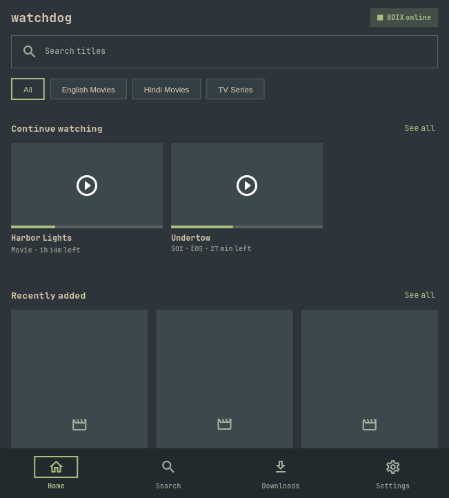
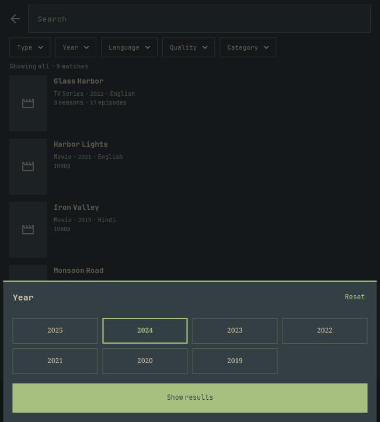
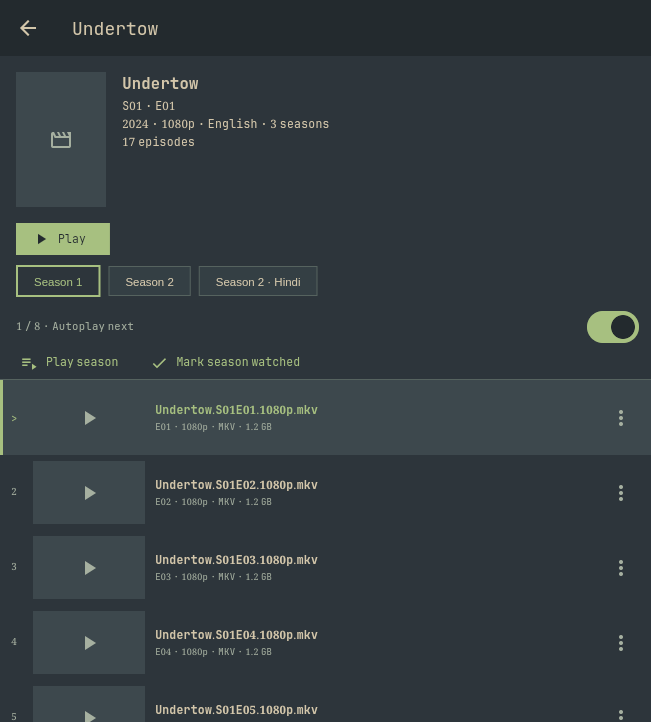
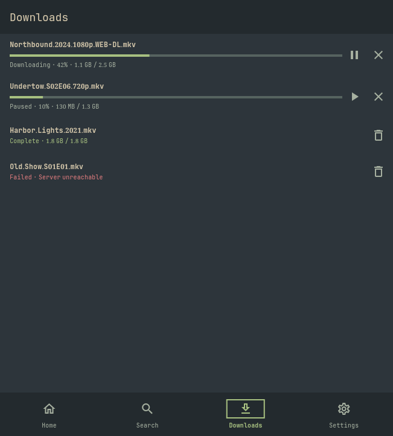

# watchdog

Unofficial Flutter client (Android and Linux) for browsing and playing media from the DhakaFlix h5ai servers.

## Disclaimer

- watchdog is **unofficial**: not affiliated with, authorized by, or endorsed by Sam Online or DhakaFlix.
- It **hosts no media** and ships no catalog or server data. It reads directory listings from servers you can reach and builds a local index on your device.
- You supply reachable servers. You are responsible for following the law and each server's terms.

## BDIX requirement

The DhakaFlix servers are reachable only from a BDIX-peered ISP in Bangladesh, not from cloud hosts or CI. Crawling and playback need that connection; the local index can be searched offline. The first run builds a lightweight index in seconds to a few minutes (the app is usable meanwhile); episode and file lists are fetched when you open a title.

## Features

- Fast first run: the library index is usable within seconds and complete in a few minutes; file and episode lists load when you open a title, so the index stays small (about 25 MB for ~40k titles)
- Browse by category, search with fuzzy matching, filter by year, language and category
- Optional TMDB details (bring your own free API key in Settings): posters, ratings, genres, plot, cast, plus genre, rating, language, runtime and actor filters, and search by actor name
- Storage controls in Settings: index, image cache and downloads sizes with clear buttons
- Series view as a playlist of seasons and episodes
- In-app player (media_kit/libmpv): opens like YouTube (video pinned at the top, playlist below), fullscreen on demand, audio and subtitle track switching
- VLC-style gestures: swipe left/right to seek, swipe the right half for volume and the left half for brightness, double-tap sides for ±10 s, hold for 2x speed
- Hand-off to an external player, copy link
- Downloads with live speed and time left; finished files are saved to `Movies/watchdog` so file managers and other apps see them
- In-app updates (Android): checks the GitHub releases, downloads the APK and opens the installer
- Themes (Everforest default, Tokyo Night, Catppuccin Latte) and Box/Rounded shapes

## Screenshots

_Screenshots were taken from earlier builds; the Settings screen (now six groups) and title screens (TMDB block) look different today._

| | | |
|---|---|---|
|  |  |  |
|  |  |  |
|  | | |

## Build from source

Toolchain is pinned in `mise.toml` (Flutter 3.50.1, JDK 17). Android SDK at `~/Android/Sdk` or `ANDROID_HOME`.

```sh
scripts/build-android.sh      # flutter build apk --release --split-per-abi --target-platform android-arm64; prints path, size, sha256
scripts/install-android.sh    # adb install -r, then starts the app
scripts/build-linux.sh        # Linux release bundle
```
Manual equivalent:
```sh
eval "$(mise env)"; export ANDROID_HOME=~/Android/Sdk
flutter build apk --release --split-per-abi --target-platform android-arm64
adb install -r build/app/outputs/flutter-apk/app-arm64-v8a-release.apk
```

### Releases and in-app updates
Latest release: [v0.3.1](https://github.com/mahmudulHmanik/watchdog/releases/latest) (arm64 APK + SHA-256). `scripts/release.sh` builds the signed arm64 APK and publishes it as a GitHub release (needs `gh` and `android/key.properties`). The app compares the newest release tag with its own version (it asks the GitHub API first and falls back to the public release feed when the anonymous API limit is hit). Android only installs an update over an existing install when it is signed with the same key, so keep the keystore backed up and never swap it. Bump `version:` in `pubspec.yaml` and `appVersion` in `lib/core/app_info.dart` together (the build number must increase).

Debug builds install beside the release app (`dev.watchdog.watchdog.debug`); run them with `--dart-define=FILE_PROVIDER_AUTH=dev.watchdog.watchdog.debug.fileprovider`.

### Linux
Needs gtk3, libsecret (headers, pulled in by the secure-storage plugin), cmake, ninja, clang and the system mpv/libmpv (for example `pacman -S mpv gtk3 libsecret`). A desktop entry and icon are in `packaging/linux/`.

## Adding servers

Server addresses live in the app's configuration. Android blocks cleartext HTTP to hosts not listed in `android/app/src/main/res/xml/network_security_config.xml`; the default DhakaFlix hosts are listed there. To use another host, add it to that file and rebuild.

## Known limitations

- TMDB filters and actor search only cover titles already looked up (the background fill takes a while on a full library).
- In-app update needs "Install unknown apps" allowed for watchdog (Android asks once). Linux only shows the release page.
- Opening a title you have never opened needs the BDIX connection (its file list is fetched then).
- Pinch-to-zoom is not implemented yet.
- The Linux build needs `cmake` and libsecret headers; it has only been verified headless.
- ASS subtitle styling on Android may be limited.

## Author

mhm

## Credits

This product uses the TMDB API but is not endorsed or certified by TMDB.

## License

Apache-2.0, see [LICENSE](LICENSE) and [NOTICE](NOTICE). The Android build bundles LGPL-licensed libmpv/FFmpeg; the analysis and the pending decision are in [docs/LICENSE-ANALYSIS.md](docs/LICENSE-ANALYSIS.md). Dependency licenses: [docs/THIRD_PARTY.md](docs/THIRD_PARTY.md).
